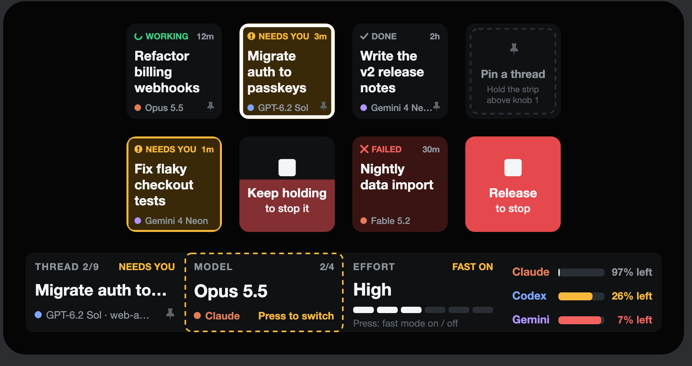

# T3 Code Deck

A Stream Deck+ plugin for [T3 Code](https://t3.codes). Your agent threads live on the keys, and the knobs pick a thread, switch its model, set its effort and show how much Claude, Codex and Gemini usage you have left.

Not affiliated with T3 Code or Elgato.



## Install

1. Download `io.github.antoinersx.t3codedeck.streamDeckPlugin` from [Releases](../../releases) and double-click it.
2. In the Stream Deck app, add a new page to the profile you already use (it sits next to your other pages, so you keep them).
3. From the **T3 Code Deck** category, drag **Thread** onto all 8 keys and **Threads**, **Model**, **Effort**, **Usage** onto the 4 knobs, left to right. Knob actions show in the list when a knob slot is selected. The keys sort themselves by position: top row pinned, bottom row live.
4. Keep T3 Code open. The plugin signs itself in the first time and shows up as "T3 Code Deck" in T3's sessions.

Needs macOS 12+, Stream Deck 6.5+ and a Stream Deck+ (8 keys, 4 knobs, touch strip). The actions also work on other Stream Decks if you place them by hand.

## What each control does

| Control | Shows | Press | Other |
|---|---|---|---|
| Top row keys | Your pinned threads (T3's own pins) | Open in T3 Code | Hold 1 s: stop a working thread |
| Bottom row keys | Other active threads: needs you, then working, then failed, then the rest | Open in T3 Code | Hold 1 s: stop |
| Knob 1 · Threads | The selected thread, its project and model | Open it | Turn: select · Hold the strip: pin / unpin |
| Knob 2 · Model | Your favourite models from T3 Code | Switch the selected thread to it | Turn: pick a favourite |
| Knob 3 · Effort | Effort level and fast mode | Fast mode on / off | Turn: change effort |
| Knob 4 · Usage | Claude, Codex and Gemini limits left | Refresh | Turn: details per provider |

Each key shows the thread's state by shape and colour: amber with **!** when it needs you, green ring while working, red **×** when it failed, a check when done. When a thread starts needing you, the whole strip turns amber for 8 seconds; tap it to jump there.

## How it works

The plugin is plain Node with one dependency (`ws`) and no build step. Three files in `bin/`:

- `t3.js` talks to the T3 Code server on your Mac:
  - **Threads, models, pins and stop** go through T3's MCP endpoint (`<origin>/mcp`), the same tools T3 gives outside agents (`t3_thread_list`, `t3_thread_configure`, `t3_thread_organize`, `t3_thread_interrupt`, `orchestrator_capabilities`).
  - **Sign-in** is T3's standard MCP OAuth flow. The plugin approves it with a one-time pairing code from T3's own `t3` command (`~/.t3/bin/t3 auth pairing create`), so you never click anything. It asks for full access because T3 refuses changes to a full-access thread from a narrower caller. Tokens last 30 days and renew on their own.
  - **Usage** comes from T3's app WebSocket (`server.getConfig`). This is the one part that isn't a published surface. If a T3 update changes it, only the Usage knob shows "Unavailable".
  - **Favourite models** are read from `~/.t3/userdata/settings.json`.
- `render.js` draws every key (144×144) and strip panel (200×100) as SVG.
- `plugin.js` speaks the Stream Deck SDK v2 protocol, polls T3 every 2 seconds and handles keys and knobs.

Tokens are stored in `~/Library/Application Support/T3 Code Deck/auth.json` (mode 600), next to `plugin.log`.

## Build on it

```sh
cd io.github.antoinersx.t3codedeck.sdPlugin/bin && npm install   # ws
node ../../tools/preview.js        # renders every key and strip state to preview.html
python3 tools/make_icons.py        # PNG icons (needs Pillow)
streamdeck validate io.github.antoinersx.t3codedeck.sdPlugin
streamdeck pack io.github.antoinersx.t3codedeck.sdPlugin -o dist --force
```

To try a linked copy:

```sh
streamdeck link io.github.antoinersx.t3codedeck.sdPlugin
```

Ideas that fit: a second page with **New thread** and saved prompts, answering a waiting question from the deck, other Stream Deck models, Windows and Linux paths.

## License

MIT
